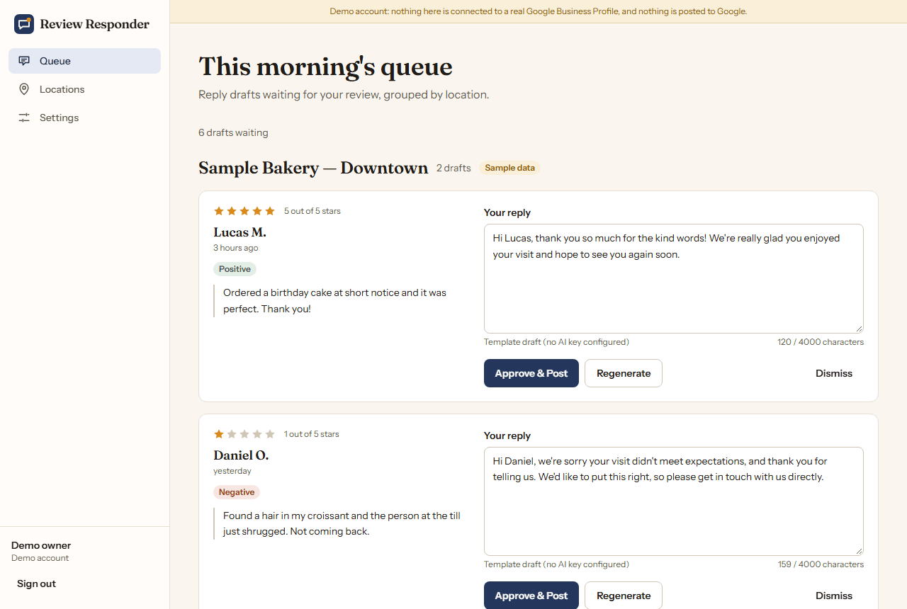
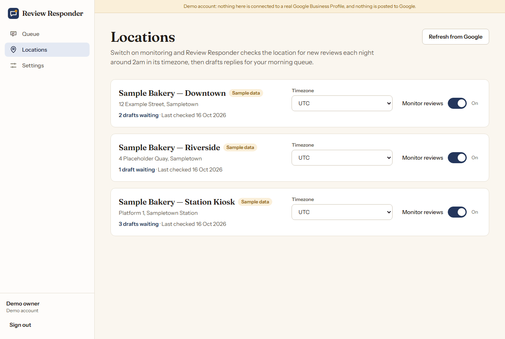
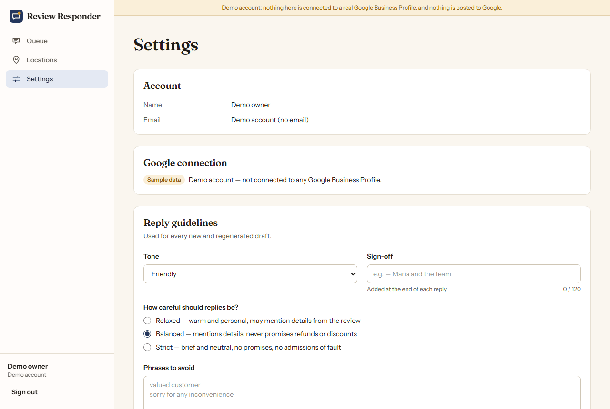
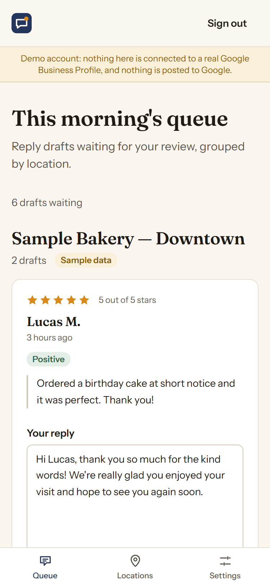

# Review Responder

Review Responder helps a local business keep up with its Google reviews. It fetches new reviews for the Google Business Profile locations you choose to monitor, drafts a reply to each one overnight, and leaves the drafts in a morning queue where you edit, approve and post them. Nothing is posted until you approve it.

**Live demo:** https://review-responder-rho.vercel.app (choose "Try the demo"; it uses labelled sample data). The API runs on Render's free tier, which sleeps when idle, so the first request after a quiet spell can take about a minute while it wakes up; the app shows a notice while it waits.



## Status

This is an early build. Working so far:

- Sign-in with Google (OAuth 2.0 with the Business Profile scope), or a "Try the demo" sign-in that creates a private, throwaway account
- Database schema for users, Google accounts, locations, reply guidelines, reviews, drafts and API usage logs
- Per-user access control on locations, reviews and drafts, plus an admin role
- Locations page: refresh locations from Google, switch monitoring on or off, and set each location's timezone
- Nightly review sync: each monitored location is checked at about 2am in its own timezone, new reviews are stored, and a reply draft with sentiment and themes is generated for each one
- Demo accounts get three sample bakery locations with sample reviews and drafts straight away, labelled "Sample data"
- Review queue: pending drafts grouped by location, inline editing, "Approve & Post" (posts the reply to Google straight away), dismiss, and regenerate with a tone (more apologetic, more casual, more formal, shorter). Failed drafts can be retried or written by hand
- Settings: reply guidelines (tone, how careful replies should be, sign-off, phrases to avoid, notes for the drafter) that feed every new and regenerated draft, and morning email preferences (on/off, hour, timezone)
- Morning summary email: once a day at the owner's chosen local hour, only when there are new drafts, listing new drafts per location and any failed drafts, with links to the queue and to notification settings. Demo accounts never receive email
- Admin page: API usage for the last 7 days by service and action (calls, failures, average time), recent failures, failed and queued jobs, and account, location and draft totals. Aggregates only, no personal data
- Privacy Policy, Terms of Service and FAQ pages. New Google accounts confirm once that they are 18 or older, authorized to manage the business profile, and accept the Terms; the demo asks for the same confirmation before it starts
- Account deletion
- Demo accounts, with all their sample data, are deleted 24 hours after they are created

## Screenshots

All screenshots show a demo account with labelled sample data.

| Locations | Settings | Queue on a phone |
|---|---|---|
|  |  |  |

## Stack

| Part | Technology |
|---|---|
| `api/` | Laravel 13 (PHP 8.4), Laravel Sanctum bearer tokens, MySQL 8 or PostgreSQL, database queue and cache |
| `web/` | React 19, Vite, Tailwind CSS 4, React Router, axios — plain JavaScript/JSX |

## Local setup

You need PHP 8.3+ (with `pdo_mysql`, `mbstring`, `openssl`), Composer, MySQL 8 and Node 20+.

### 1. Database

As a MySQL user that can create databases and users:

```sql
CREATE DATABASE review_responder CHARACTER SET utf8mb4 COLLATE utf8mb4_unicode_ci;
CREATE DATABASE review_responder_test CHARACTER SET utf8mb4 COLLATE utf8mb4_unicode_ci;
CREATE USER 'review_responder'@'127.0.0.1' IDENTIFIED BY 'choose-a-password';
GRANT ALL PRIVILEGES ON review_responder.* TO 'review_responder'@'127.0.0.1';
GRANT ALL PRIVILEGES ON review_responder_test.* TO 'review_responder'@'127.0.0.1';
```

### 2. API

```bash
cd api
composer install
cp .env.example .env        # then set DB_PASSWORD
php artisan key:generate
php artisan migrate
php artisan serve --port=8472
```

To give an account the admin role (there are no built-in admin credentials):

```bash
php artisan user:promote owner@example.com
```

### 3. Web app

```bash
cd web
npm install
cp .env.example .env.local
npm run dev                 # http://localhost:5472
```

### Tests and checks

```bash
cd api && php artisan test && ./vendor/bin/pint --test
cd web && npm run lint && npm run build
```

Browser tests (Playwright) start their own API on port 8472, using a throwaway SQLite database in the system temp folder, and the web app on port 5482:

```bash
cd web
npx playwright install chromium   # first time only
npm run test:e2e                  # set PHP_BINARY if php is not on your PATH
```

## Environment variables

### `api/.env`

| Variable | Purpose |
|---|---|
| `DB_*` | Database connection. `DB_CONNECTION` is `mysql` or `pgsql`; for PostgreSQL also `DB_SEARCH_PATH` (the schema, default `public`) and `DB_SSLMODE` (`require` for hosted databases) |
| `FRONTEND_URL` | Origin(s) of the web app, comma-separated. Used for CORS; the first one receives the Google sign-in redirect |
| `SANCTUM_EXPIRATION` | API token lifetime in minutes (default 7 days) |
| `GOOGLE_DRIVER` | `demo` (labelled sample locations and reviews) or `real` (Google Business Profile APIs) |
| `GOOGLE_CLIENT_ID`, `GOOGLE_CLIENT_SECRET`, `GOOGLE_REDIRECT_URI` | Google OAuth client. Google sign-in is offered only when all three are set. The redirect URI is this API's `/api/auth/google/callback` and must be registered in the Google Cloud console |
| `DEMO_LOGIN_ENABLED` | Show "Try the demo" (default `true`) |
| `LLM_BASE_URL`, `LLM_API_KEY`, `LLM_MODEL` | Any OpenAI-compatible chat completions endpoint for drafting replies (defaults to OpenRouter and a free model). Without a key, drafts come from fixed star-based templates and are labelled as template drafts |
| `CRON_SECRET` | Shared secret for `POST /api/cron/run` (see below). Empty disables the endpoint |
| `MAIL_MAILER` | `log` (default locally: emails are written to `storage/logs/laravel.log`), `smtp` or `ses` |
| `MAIL_FROM_ADDRESS`, `MAIL_FROM_NAME` | Sender of the morning summary. Use an address on a domain your mail provider is set up to send from |
| `MAIL_HOST`, `MAIL_PORT`, `MAIL_USERNAME`, `MAIL_PASSWORD`, `MAIL_SCHEME` | SMTP server, when `MAIL_MAILER=smtp`. Mailgun (`smtp.mailgun.org`), Amazon SES, Brevo and most other providers offer SMTP credentials, so this needs no extra packages. Use port 587 |
| `AWS_ACCESS_KEY_ID`, `AWS_SECRET_ACCESS_KEY`, `AWS_DEFAULT_REGION` | Amazon SES API, when `MAIL_MAILER=ses` (also run `composer require aws/aws-sdk-php`) |

The Business Profile scope (`business.manage`) is a restricted Google scope: until Google approves your project, only test users you add in the Google Cloud console can sign in.

### `web/.env.local`

| Variable | Purpose |
|---|---|
| `VITE_API_URL` | Base URL of the API, including `/api` |

## Scheduling

Review syncing runs on the Laravel scheduler and the database queue:

```bash
php artisan schedule:work      # or a cron entry: * * * * * php artisan schedule:run
php artisan queue:work
```

`reviews:sync`, `summaries:send` and `demo:prune` all run hourly.

`reviews:sync` Each run queues only monitored locations where the local time is between 02:00 and 02:59 and that have not been synced that local day. A sync fetches reviews from the last 24 hours, or back to the start of the last synced day if nights were missed (at most 30 days), skips reviews already answered on Google, and queues one draft per new review. For a manual run: `php artisan reviews:sync --force` (all monitored locations) or `--location=ID`.

On hosts without cron, the `Review sync` GitHub Actions workflow (`.github/workflows/sync-cron.yml`) calls `POST /api/cron/run` hourly with `Authorization: Bearer $CRON_SECRET`, which runs `reviews:sync` and then works the queue until it is empty. Set the repository variable `API_URL` and secret `CRON_SECRET` to enable it.

`summaries:send` emails each owner who has the daily summary switched on, when it is their chosen hour in their timezone, at most once per local day, and only if drafts were created since their last summary. Each email is sent from the queue and recorded in the API usage log. The cron endpoint runs it too, after `reviews:sync`.

`demo:prune` deletes demo accounts that are more than 24 hours old, together with their locations, reviews, drafts and sign-in tokens. Accounts created with Google are never touched. The cron endpoint runs it after `summaries:send`.

## Deploying the API

`api/Dockerfile` builds a production image (FrankenPHP, PHP 8.4, OPcache, `pdo_pgsql` and `pdo_mysql`) that listens on `$PORT` (default 8080). It sets `APP_ENV=production`, `APP_DEBUG=false` and logs to stderr; it contains no secrets, so set `APP_KEY`, the `DB_*` variables and the other variables above in the host's environment. On every start, `api/docker/start.sh` caches config and routes, runs `php artisan migrate --force`, switches on row level security for every table when the database is PostgreSQL (`php artisan db:enable-rls`), starts a queue worker and then the web server. Review sync, summaries and demo pruning are triggered by the `Review sync` workflow (see Scheduling).

The live API runs at `https://review-responder-api.onrender.com` as a Render Docker web service (root directory `api`, free plan, Singapore region, health check `GET /api/health`, deploys on every push to `main`). Its database is a dedicated `review_responder` schema in a Supabase PostgreSQL project, reached through the session pooler with `DB_SSLMODE=require`. It runs with `GOOGLE_DRIVER=demo`, `MAIL_MAILER=log` and no `LLM_API_KEY`, so the live demo uses template drafts.

For PostgreSQL in a dedicated schema of a shared database (for example a Supabase project), give the app its own login role that owns the schema, with no access granted to other roles, and set `DB_SEARCH_PATH` to that schema. The app role owns its tables, so row level security does not restrict it, while every other role is denied.

## Deploying the web app

The web app is deployed on Vercel at `https://review-responder-rho.vercel.app` (project root `web`, Vite preset, deploys on every push to `main`) with `VITE_API_URL=https://review-responder-api.onrender.com/api`. If the site is deployed elsewhere, replace the address in `web/src/lib/site.js` (the build writes it into the canonical and social tags in `index.html`), `web/public/robots.txt` and `web/public/sitemap.xml`. The social preview image `web/public/og-image.png` is a screenshot of the queue in a demo account.

`web/vercel.json` sets a Content-Security-Policy whose `connect-src` allows `'self'` and the API origin (`https://review-responder-api.onrender.com`). If the API moves, update that origin, or the app cannot reach the API.

## Security

Google refresh and access tokens are encrypted at rest and never sent to the browser. Sign-in finishes with a single-use code bound to the browser tab that started it, so no token ever appears in a URL. See [SECURITY.md](SECURITY.md) to report a vulnerability.

## License

Free for personal, educational and other noncommercial use under the [PolyForm Noncommercial License 1.0.0](LICENSE).

## Commercial use

Using Review Responder for commercial purposes requires a paid commercial license. Contact fazalabbas2002@gmail.com.
